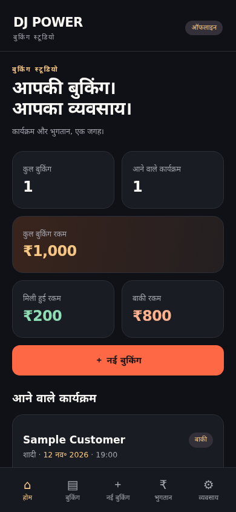
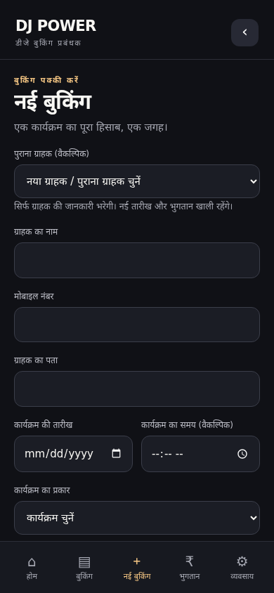
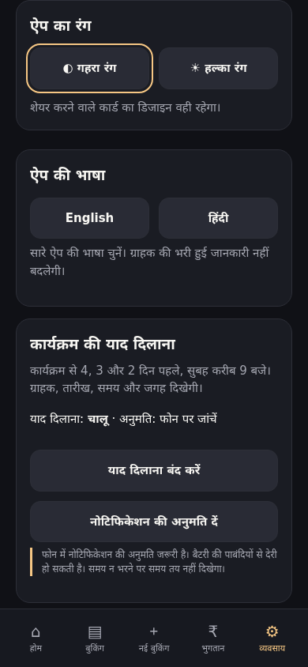
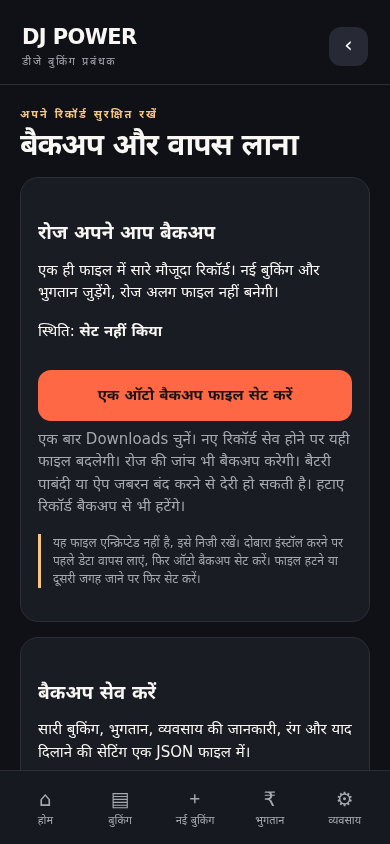
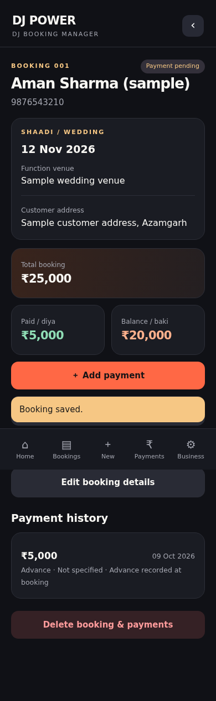
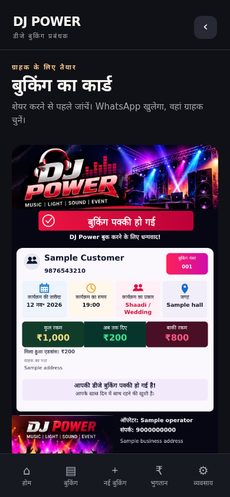
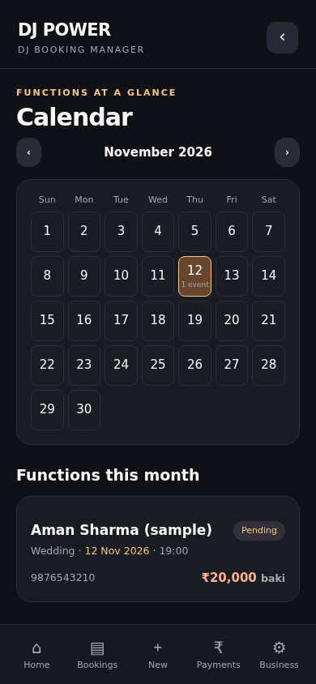
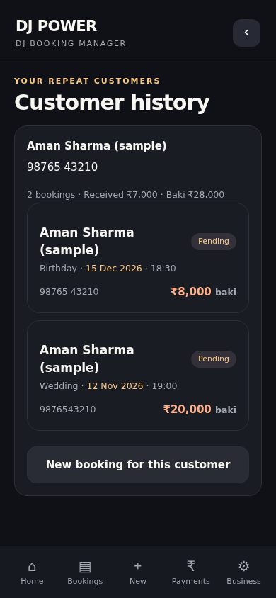

# DJ POWER Booking Studio

An offline Android app for a DJ or event-service business to keep bookings, customer details, payments and upcoming functions in one place. Hindi and English interfaces make the same app usable by people who prefer either language.

**Current source:** v1.5 · **Android:** 8.0+ · **Package:** `com.akash.djpower` · **Storage:** on the device · **Backend:** none

## What problem does it solve?

A booking has an event date, venue, agreed amount, advance and later payments. DJ POWER keeps those together, shows the balance, and creates a customer-facing booking card or payment reminder. You do not need an account or an internet connection to manage records. WhatsApp sharing requires WhatsApp and its usual connectivity.

## Screenshots

All records and business details shown below are sample data, not live customer records. These are app-interface previews, not proof of testing on a physical Android phone.

<table>
<tr><td><b>Hindi dashboard</b><br></td><td><b>New booking</b><br></td></tr>
<tr><td><b>Language and theme settings</b><br></td><td><b>Backup and restore</b><br></td></tr>
<tr><td><b>Booking and payments</b><br></td><td><b>Customer share card</b><br></td></tr>
<tr><td><b>Calendar</b><br></td><td><b>Customer history</b><br></td></tr>
</table>

## Features

| Area | What you can do |
| --- | --- |
| Dashboard | See total bookings, upcoming functions, agreed totals, received payments and pending balances. |
| Bookings | Save customer name, phone, address, event date/time, event type, venue, notes and amount. Choose a custom event type when needed. Edit or delete records. |
| Booking numbers | Readable sequential numbers start at 001. Editing keeps the number; deleting does not reuse it. Numbers continue past 999. |
| Payments | Add an advance and later dated Cash/UPI payments, correct or delete payments, and see the remaining balance. Amounts use integer paise to avoid floating-point money errors. |
| Search and filters | Find a booking by name or phone and filter by date or pending payment. |
| Customer cards | Preview a designed booking confirmation or payment-reminder image, then choose the recipient in WhatsApp or the Android share sheet. Nothing is sent automatically. |
| Monthly reports | Export a PDF and a real XLSX workbook. Income is grouped by payment date; function-month reports show current balances, not historical month-end balances. |
| Calendar | Browse functions by month and open bookings for a selected date. |
| Customer history | Group repeat customers by normalized phone number. Reuse contact details without copying an old event date or payments into a new booking. |
| Reminders | Local notifications around 09:00, 4, 3 and 2 days before a function, subject to Android permissions and scheduling. |
| Appearance | Persistent dark/light theme and mobile-friendly layouts. |
| v1.4 backup/restore | One auto-backup JSON file, separate manual exports, validation and a restore preview before replacing records. |
| v1.5 language | Business → App language → हिंदी / English. The choice persists and travels with backups. |

## First use

1. Install your signed APK on an Android 8+ phone.
2. Open **Business** and enter your operator name, business contact and address. This public source leaves those fields empty for privacy.
3. Choose the theme and app language.
4. Allow notifications if you want event reminders.
5. Set up an auto-backup file through **Business → Backup & restore** and save a separate manual copy somewhere safe.
6. Tap **New booking**, enter the event and customer details, record the advance, then save.
7. Open a booking to add later payments or preview its share card. Review the card before selecting a recipient.

Hindi quick start: **व्यवसाय** में अपनी जानकारी भरें, **ऐप की भाषा** चुनें, **बैकअप और वापस लाना** सेट करें, फिर **नई बुकिंग** जोड़ें। ग्राहक का कार्ड भेजने से पहले जांचें।

### Language behavior

The toggle changes app labels, navigation, forms, confirmations, errors, backup screens, report labels and share-card labels. Customer names, addresses and typed notes are not translated. Technical names such as JSON, PDF, Excel and WhatsApp stay recognizable. Android's keyboard, file picker and native date/time controls follow the phone's language settings, not this app toggle. Older backups without a language field open in English.

## Backup, restore and data safety

Auto backup requires one-time file access through Android's system picker. Choose a file outside app storage, such as in Downloads. Saved changes update that same snapshot; a background job also checks roughly daily, and the app refreshes overdue backups when opened.

- A snapshot is **not** an append-only history. Edits replace earlier values and deleted bookings disappear from the next snapshot.
- The backup includes bookings, payments, business settings, theme, language and reminder settings.
- Backup files are **not encrypted**. They contain customer contact and payment information. Keep them private.
- Battery restrictions, force-stop, device shutdown or provider errors can delay or fail writes. Read-after-write checks detect problems but cannot recover an incomplete overwritten file.
- Keep separate dated manual backups on another device or private storage. The app does not sync to Drive automatically.
- Restoring shows a preview and asks before replacing current records. Invalid files are rejected without changing records.
- After reinstalling or moving phones, restore first, then select a new auto-backup destination and allow notifications again.
- Uninstalling or clearing app data deletes on-device records. PDF/XLSX reports are not restorable backups.

## Installation and update notes

The original owner's v1.5 APK and source archive remain in private storage. This repository deliberately does not publish that APK because it includes business contact defaults. To install this privacy-clean source, build and sign your own APK as described below.

For the original owner builds, v1.5 uses the same certificate as v1.4 and can update v1.4 in place. It does **not** update v1.3 because the certificates differ. If Android shows a package conflict, do not uninstall an app with real records until you have a verified backup or another safe record of the data. Uninstalling loses local app data.

An APK you sign yourself cannot update an APK signed with another key. Keep your chosen signing key safe and reuse it for future updates. Signing keys and passwords are not included in this repository.

## Technology and architecture

This is an Android **WebView app**, not a Kotlin/Compose app. The UI is HTML/CSS/JavaScript, with a Java Android shell for device capabilities. It has no backend and requests no Internet permission.

- `assets/app.js`: booking/payment state, navigation, validation and calculations.
- `assets/i18n.js`: Hindi/English labels and interface translation.
- `assets/backup.js`: JSON backup validation, preview and restore.
- `assets/card.js`: Canvas customer cards and payment reminders.
- `assets/reports.js`: PDF/XLSX report generation.
- `src/com/akash/djpower/`: WebView host, local persistence, notifications, sharing and backup jobs.
- `res/`: app icons and Android theme.
- `AndroidManifest.xml`: Android 8+ minimum, target API 34, versionCode 6.
- Playwright/Node.js: browser regression tests and screenshots.

Android stores the app state locally through the Java bridge; browser previews use localStorage. Android file access uses the Storage Access Framework rather than broad storage permission. Notifications need permission on Android 13+ and may be delayed by the OS. Force-stop can prevent reminders until the app is opened again.

## Source layout

The complete, privacy-clean project is in **3-DJ-POWER-v1.5-source-public.zip** in this repository. Download and extract it before running commands. The archive contains the source tree, build script, tests, documentation and screenshots. The root README and screenshots provide an overview without extracting it.

```text
assets/                  HTML, CSS, JavaScript and card artwork
src/com/akash/djpower/    Java Android shell
res/                     Android resources
AndroidManifest.xml      Package, versions and permissions
build.sh                 Android command-line build
*-test.mjs               Browser regression suites
screens.mjs              Sample-screen generation
screenshots/             README previews
```

## Build from source

Requirements: Linux or a compatible shell, JDK 17, Android SDK platform 35 and build-tools 35.0.0, `zip`, and your own Android signing keystore. No Gradle project is supplied.

```bash
export ANDROID_HOME=/path/to/android-sdk
export JAVA_HOME=/path/to/jdk-17
export PATH="$JAVA_HOME/bin:$PATH"
export DJ_POWER_KEYSTORE=/private/path/release.jks
export DJ_POWER_KEY_ALIAS=your_alias
export DJ_POWER_STORE_PASS_FILE=/private/path/keystore-password.pass
bash build.sh
```

Set those variables to your own local paths. Keep the password file outside the repository with restricted file permissions. Never commit credentials. `build.sh` fails if signing inputs are missing; it does not silently generate another signing identity. The default output is `out/DJ-POWER-v1.5.apk`.

You may set `BUILD_TOOLS_VERSION` or `DJ_POWER_APK_OUTPUT` to override the build-tools version or output path. The public build script has portable toolchain paths; its APK compilation has not been rerun as part of preparing this repository. The original v1.5 build compiled and its certificate was verified before delivery.

## Preview and tests

To preview the interface, open `assets/index.html` in a modern browser. Android-only features such as native notifications and persisted file access do not work as Android features in that preview.

For the supplied tests, install Node.js and Google Chrome at `/usr/bin/google-chrome-stable`, then run:

```bash
npm ci
npm test
```

Tests use Playwright and write sample output files into `/downloads`; create a writable directory there or adjust those output paths for your machine. Each test uses an isolated browser session and sample records. If Chrome is installed elsewhere, adjust `executablePath` in the test files.

### Verification status

All seven browser suites were rerun on the privacy-clean source and passed:

- Booking/payment math, create/edit/delete, validation, search and persistence.
- Corrupt-load protection and failed-save rollback.
- Dark/light themes and 320/390px layout checks.
- Calendar, customer history, safe repeat booking, PDF/XLSX generation and reminder settings.
- Sequential booking-number migration, deletion, edits and numbers above 999.
- Real JSON export → clear browser storage → import → preview → restore → exact state equality; ten invalid-file cases rejected.
- Hindi/English persistence on 14 routes at 320/390px; language backup/restore; translated option labels retain their original values; booking/payment records unchanged by language switching.

**Still needs physical-device testing:** installation and update behavior, Android system file picker and persistent URI access, Downloads survival after uninstall, WhatsApp attachment handoff, native notifications, reboot behavior and daily background backup scheduling. Browser storage reset is not an Android uninstall test.

## Privacy and scope

No live bookings, customer database, backup files, signing secrets or APK with private business defaults are published. The source starts with no bookings and blank operator/contact/address/Instagram fields. The original business gear photo containing phone numbers is excluded. Cards and reports contain whatever users enter locally, so review them before sharing.

This app records payments manually; it does not transfer money, run a payment gateway, automatically message customers or provide cloud recovery.
